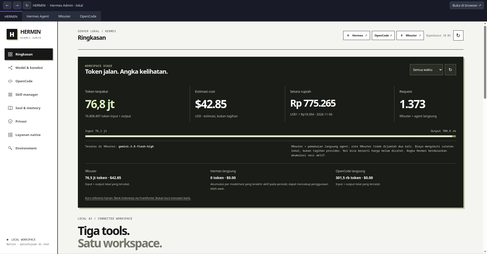
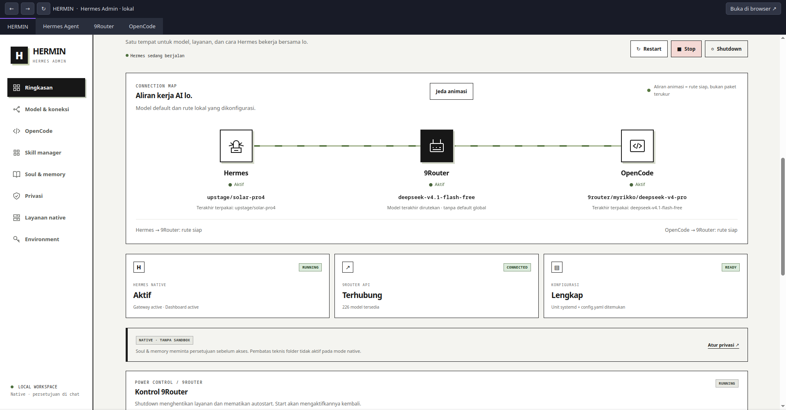

# HERMIN · Hermes Admin


**0.0.1-beta** · © 2026 utiedev

Dashboard lokal untuk mengelola **Hermes Agent, OpenCode v2, dan 9Router** dari satu tempat. Dibuat oleh Azlan. Tampilan hitam-putih, akses localhost, login admin, dan konfirmasi sebelum perubahan.

HERMIN adalah control panel untuk aplikasi yang dipasang secara terpisah. Repo ini berisi kode HERMIN dan alat setup layanan, tanpa binary agent, akun provider, percakapan, atau API key.

## Mulai di sini

**Clone repo dan `manage.py install` hanya memasang HERMIN.** Node.js, Hermes, OpenCode v2, dan 9Router perlu dipasang tersendiri. Lolos tes HERMIN tidak berarti ketiga aplikasi sudah terpasang.

Untuk mesin baru ikuti **[panduan setup berurutan](docs/SETUP.md)** dari awal:

| Urutan | Yang dipasang/disiapkan | Lokasi |
|---|---|---|
| 1 | Paket OS dan Node/npm | runtime resmi per user |
| 2 | Source HERMIN | `~/server-lokal/hermin/repo` |
| 3 | Hermes melalui installer resmi dengan `--dir` dan `--hermes-home` | aplikasi `hermes/app`, data `hermes/data` |
| 4 | 9Router melalui build source resmi | aplikasi `9router/app`, provider/database `9router/data` |
| 5 | OpenCode v2 `@opencode/cli`, npm prefix khusus | `opencode/bin/opencode` dan `opencode/lib` |
| 6 | Unit layanan dan dashboard HERMIN | systemd user + `hermes/control-dashboard` |
| 7 | Konfigurasi provider/model **atau** restore backup lokal | data milik user |
| 8 | Start, doctor, tes chat, dan SSH/Tailscale | localhost |

Semua path aplikasi/data pada tabel relatif terhadap `~/server-lokal`. Repo source dipisahkan dari data runtime agar akun/provider tidak ikut Git. Jika sudah mempunyai clone di `~/server-lokal` atau lokasi lain, pertahankan dan gunakan direktori aktual itu, bukan menyalin contoh path baru secara membabi buta. Lihat [panduan instalasi yang sudah ada](docs/SETUP.md#instalasi-yang-sudah-ada).

## Fitur

- Start, stop, restart, shutdown/autostart layanan Hermes dan 9Router.
- Pilih model/combo dari katalog 9Router; daftar Nous Portal membedakan model gratis jika metadata tersedia.
- Simpan API key 9Router secara lokal dan atur model OpenCode.
- Buka Hermes, 9Router, dan OpenCode Web; OpenCode menggunakan pairing sekali pakai.
- Skill manager: pencarian, filter status/aplikasi, aktifkan/pause, validasi ulang, restart Headroom, hapus ke backup, buka/salin lokasi.
- Editor Soul, memory, profil pengguna, environment, dan unit layanan.
- Statistik token/cost yang tersedia di database 9Router.
- Periksa update HERMIN dari GitHub melalui **Layanan native → Update HERMIN**.

## Preview





### Logo

- [SVG vector asli](hermin/assets/hermin-logo.svg), semua teks berupa path agar tidak bergantung pada font host.
- [PNG HD transparan 3024 × 1008](hermin/assets/hermin-logo.png), dengan alpha asli, cocok untuk presentasi dan publikasi.

PNG tetap raster dan memiliki batas resolusi; gunakan SVG untuk ukuran bebas. Logo dapat dibangun ulang memakai `python3 scripts/build-logo.py` dengan pycairo dan font Liberation Sans/Noto Sans Mono pada mesin desain. File SVG/PNG hasilnya sudah disertakan, sehingga instalasi HERMIN tidak membutuhkan Cairo maupun font tersebut. Preview di atas adalah tangkapan layar yang diberikan pemilik project dan mungkin menampilkan tampilan sebelum logo vector dipasang.

## Ringkasan usage dan koneksi

Token, estimasi USD, nilai rupiah dan request tampil di bagian atas. Total menggabungkan seluruh trafik 9Router dengan pemakaian Hermes/OpenCode langsung ke provider lain. Pemakaian yang diarahkan ke 9Router dikeluarkan dari angka langsung agent agar tidak dijumlah dua kali. Sumber yang belum tersedia atau rute yang tidak diketahui ditandai; isi percakapan tidak dibaca untuk perhitungan ini.

Kurs USD/IDR berasal dari referensi harian **Bank Indonesia melalui [Frankfurter](https://frankfurter.dev/)**. Tanggal data ditampilkan, cache diperbarui berkala, dan kurs lama ditandai saat data hari ini belum terbit/koneksi gagal. API kurs hanya menerima permintaan pasangan USD/IDR, tanpa data usage, key, atau pesan pengguna. Ini kurs referensi harian, bukan harga transaksi bank atau kurs intraday.

**Periode:** 9Router memakai timestamp request, OpenCode memakai waktu pesan assistant, sementara Hermes menyimpan akumulasi per model/rute sesi. Pada filter 24 jam/7 hari/30 hari, angka Hermes adalah seluruh akumulasi sesi yang terakhir aktif dalam periode dan bisa mencakup pemakaian sebelum periode itu. Default **Semua waktu** menghindari batas waktu yang tidak sebanding. Biaya nol bisa berarti gratis atau harga belum dicatat; semua angka estimasi lokal, bukan tagihan provider. Token yang ditampilkan adalah input + output tercatat, tanpa menjumlah ulang bucket cache/reasoning terpisah.

Diagram memperlihatkan default Hermes dan OpenCode, serta model terakhir yang dirutekan 9Router (router tidak punya satu default global). Kabel menyala saat rute localhost:20128 dikonfigurasi, layanan agent aktif dan API 9Router terbaca. Ini indikasi kesiapan konfigurasi, bukan packet capture atau bukti request inferensi berhasil. Provider langsung/rute lain/offline ditampilkan dengan kabel terputus. Animasi bisa dijeda dan menghormati reduced motion.

Adapter usage mendukung schema `usageHistory` 9Router, `session_model_usage` Hermes, dan `session_message`/`message` OpenCode. Perubahan schema upstream ditampilkan sebagai data belum tersedia. Plugin/provider dengan nama lain yang menunjuk 9Router di localhost:20128 juga dikecualikan dari usage langsung berdasarkan config saat ini.

## Kebutuhan

Linux dengan Python **3.11+**, modul `venv`/pip, Git, dan systemd user session. Ubuntu 24.04 dan Fedora adalah target; jalankan sebagai user biasa, bukan root. Node diperlukan oleh 9Router/OpenCode dan pemeriksaan JS, bukan server HERMIN. Gunakan Node 24 LTS untuk panduan stack di bawah.

Ubuntu:

```sh
sudo apt-get update
sudo apt-get install -y git python3 python3-venv python3-pip curl build-essential
```

Fedora:

```sh
sudo dnf install -y git python3 python3-pip curl gcc gcc-c++ make
```

User server harus mempunyai layanan systemd user. Untuk autostart sesudah reboot tanpa login, administrator dapat menjalankan `sudo loginctl enable-linger "$USER"` sebagai user tujuan. Perintah `systemctl --user show-environment` harus berhasil sebelum instalasi layanan.

## Instalasi HERMIN

Bagian ini khusus memasang dashboard setelah runtime tersedia. Pada mesin baru, ikuti [urutan setup lengkap](docs/SETUP.md) terlebih dahulu. Kalau stack sudah berjalan, gunakan root stack dan lokasi clone yang sekarang. Installer hanya memperbarui file aplikasi HERMIN dan unit `hermin.service`.

```sh
mkdir -p "$HOME/server-lokal/hermin"
git clone https://github.com/azlan07/Hermin.git "$HOME/server-lokal/hermin/repo"
cd "$HOME/server-lokal/hermin/repo"
python3 manage.py install --root "$HOME/server-lokal"
```

Installer membuat virtual environment sendiri, memasang dependency yang dipin, menjalankan tes, membuat backup, lalu menyalakan dashboard. Port default **1515**; ubah dengan `--port 1516` jika diperlukan. Port yang digunakan aplikasi lain tidak akan dibebaskan otomatis.

Buka **http://127.0.0.1:1515/**. Username adalah user Linux yang menjalankan layanan, password adalah isi file lokal ini:

```sh
cat "$HOME/server-lokal/hermes/security/hermin-admin-token"
```

Jangan kirim token ke GitHub atau masukkan ke Soul/memory. Untuk memeriksa stack:

```sh
python3 manage.py doctor --root "$HOME/server-lokal"
```

`doctor` memeriksa port dan keberadaan konfigurasi. Setelah hasilnya OK, uji satu percakapan/model nyata di Hermes dan OpenCode. Respons provider bergantung pada akun, kuota, dan ketersediaan model.

### Instalasi tanpa systemd

```sh
python3 manage.py install --root "$HOME/server-lokal" --no-systemd
```

Jalankan perintah foreground yang dicetak installer. Kontrol layanan dashboard tetap membutuhkan systemd user; mode ini berguna untuk pengembangan dan pemeriksaan instalasi.

## Setup stack baru

Lihat [panduan setup Hermes, 9Router, dan OpenCode](docs/SETUP.md). Jika aplikasinya sudah terpasang dan berjalan, jangan jalankan ulang langkah pembuatan unit.

Struktur yang dipakai HERMIN:

```text
~/server-lokal/
├── hermin/
│   ├── repo/                 # clone source HERMIN (instalasi baru)
│   ├── venv/                 # dependency dashboard
│   ├── state/                # versi terpasang dan cache
│   └── backups/              # backup deployment dan editor
├── hermes/
│   ├── app/                  # instalasi resmi Hermes
│   ├── control-dashboard/    # salinan runtime HERMIN
│   ├── data/                 # HERMES_HOME: config, .env, sessions, skills
│   ├── workspace/
│   └── security/             # token admin dashboard
├── 9router/
│   ├── app/                  # source upstream, terpisah dari repo HERMIN
│   └── data/                 # database, jwt-secret, akun provider
├── opencode/bin/opencode     # npm prefix resmi; bisa juga executable resmi dari PATH
└── maintenance/backups/skills/  # skill yang dihapus melalui UI
```

OpenCode tetap menyimpan config/state di direktori resmi user seperti `~/.config/opencode` dan `~/.local/share/opencode`. Jangan memindahkan instalasi agent yang sudah berjalan hanya untuk mengikuti contoh tree ini. Hubungkan home Hermes yang benar ke `hermes/data` bila lokasinya berbeda; gunakan `HERMIN_OPENCODE_BIN` untuk binary OpenCode di lokasi khusus.

## Penggunaan

1. **Model & koneksi:** masukkan base URL `http://127.0.0.1:20128/v1` dan API key yang dibuat di 9Router. Perbarui katalog, pilih model/combo, simpan, lalu buka chat baru.
2. **Nous Portal:** login melalui `hermes model` dengan `HERMES_HOME` instalasi yang benar. OAuth tetap dikelola Hermes; label gratis memerlukan metadata Portal.
3. **OpenCode:** konfigurasi provider 9Router terlebih dahulu sesuai panduan setup, lalu pilih model default dari menu OpenCode. Pairing Web berlaku sekali dan tidak boleh dibagikan.
4. **Skill manager:** klik baris skill untuk melihat detail dan kontrol. Penambahan skill dilakukan melalui agent. Pause mengubah nama file agar tidak dimuat di sesi baru; sesi lama bisa masih menyimpan instruksi. Fitur bawaan 9Router tidak dihapus. Pause Headroom mematikan routing kompresi, bukan prosesnya.
5. **Soul & memory:** atur perilaku dan konteks, lalu buka sesi baru. Ini instruksi model, bukan pembatas akses OS. Agent native memiliki akses sesuai user Linux-nya.
6. **Layanan native:** periksa status, log, konfigurasi unit, dan pembaruan HERMIN. Shutdown di menu berarti menghentikan layanan dan menonaktifkan autostart, bukan mematikan komputer.

Tombol **Buka folder** bekerja di komputer yang menjalankan HERMIN. Saat akses melalui SSH, gunakan **Salin lokasi**.

## Backup dan restore lokal

Perintah di bawah memakai lokasi clone yang disarankan untuk instalasi baru. Jika clone berada di tempat lain, jalankan dari lokasi aktual yang berisi `manage.py`.

Backup mencakup provider/API key dan OAuth yang tersimpan, config, Soul/personality, memory, skill, percakapan dan state aplikasi. Arsip dibuat **lokal**, bukan di GitHub. File berizin 0600; arsip tidak dienkripsi dan harus diperlakukan seperti kumpulan password.

```sh
cd "$HOME/server-lokal/hermin/repo"
python3 manage.py backup --root "$HOME/server-lokal"
```

Perintah mencetak path arsip `.tar.gz` yang benar. Lokasi default `~/server-lokal/hermin/backups/`. Untuk lokasi lain, gunakan `--output /path/privat/backup.tar.gz`. Perintah menolak menimpa arsip yang sudah ada. Kelima layanan aktif dihentikan sementara agar file/database konsisten dan dinyalakan kembali sesudah selesai atau gagal. Jangan jalankan backup saat agent sedang mengerjakan tugas penting; instans manual harus dihentikan sendiri.

Pada mesin tujuan, clone dan install HERMIN mengikuti README, serta pasang runtime resmi ketiga aplikasi mengikuti [setup stack](docs/SETUP.md). Salin arsip secara privat dengan SSH/SCP. Lalu:

```sh
python3 manage.py restore --root "$HOME/server-lokal" --archive /path/privat/backup.tar.gz
python3 manage.py doctor --root "$HOME/server-lokal"
```

Untuk instalasi yang sudah mempunyai file konfigurasi, tinjau arsip lalu tambahkan `--overwrite`. Salinan file yang ditimpa disimpan pada `hermin/backups/pre-restore-*/` dan dipulihkan jika penulisan gagal. Restore memverifikasi checksum dan menolak traversal path, link arsip, dan file khusus. Path home/root lama dalam config teks disesuaikan dengan lokasi baru. Unit systemd dibuat ulang lewat panduan setup, bukan mengeksekusi unit dari backup.

Backup **tidak menyertakan runtime/binary, virtual environment, node_modules, source aplikasi agent, cache, log, atau token login HERMIN**. Token dashboard mesin tujuan tetap milik instalasi baru. Environment/binary Fedora tidak portabel langsung ke Ubuntu; runtime resmi perlu dipasang satu kali sebelum data hasil restore dapat digunakan. Login OAuth tertentu bisa meminta autentikasi ulang pada mesin lain. File proyek di luar home data agent tidak ikut disalin.

Penambahan arsip ke Git dicegah oleh `.gitignore`; jangan gunakan `git add -f` atau mengunggahnya sebagai release asset. Lihat [cakupan dan pemulihan](docs/BACKUP.md).

## Update dan pemulihan

Gunakan lokasi clone aktual jika berbeda dari contoh berikut.

```sh
cd "$HOME/server-lokal/hermin/repo"
python3 manage.py check-update --root "$HOME/server-lokal"
python3 manage.py update --root "$HOME/server-lokal"
```

Pemeriksaan hanya mengirim permintaan metadata commit ke GitHub. Update mengambil `origin/main` dengan fast-forward, menolak perubahan lokal, lalu menjalankan installer dari source terbaru. Backup dibuat sebelum file runtime/unit diganti. Startup yang gagal memulihkan file sebelumnya. Repo bisa sudah berada pada commit baru saat pemasangan gagal; perbaiki penyebabnya lalu jalankan install lagi.

Data Hermes, konfigurasi OpenCode, dan database 9Router tidak ditimpa updater HERMIN. [Panduan maintenance](docs/MAINTENANCE.md) menjelaskan backup, rollback, dan update ketiga aplikasi. Perubahan upstream bisa memerlukan penyesuaian integrasi; jalankan tes dan doctor sesudah update. HERMIN tidak melakukan update agent secara otomatis.

## Akses server melalui SSH / Tailscale

Listener tetap localhost. Dari laptop:

```sh
ssh -L 1515:127.0.0.1:1515 -L 9119:127.0.0.1:9119 -L 20128:127.0.0.1:20128 -L 4096:127.0.0.1:4096 USER@HOST_TAILSCALE
```

Buka URL localhost di laptop. Jika port laptop sudah dipakai, gunakan port lokal alternatif untuk HERMIN, misalnya `-L 1516:127.0.0.1:1515`. Dashboard agent lain tetap perlu diteruskan dengan port yang sama karena tautannya memakai localhost. Tidak perlu membuka port publik.

## Pengembangan dan tes

```sh
python3 -m venv .venv
.venv/bin/python -m pip install -r requirements.txt
.venv/bin/python -m unittest discover -s hermin -p 'test_*.py'
.venv/bin/python -m unittest discover -s tests -p 'test_*.py'
for file in hermin/*.js; do node --check "$file"; done
```

GitHub Actions juga menguji install pada direktori kosong, autentikasi, API, dan CSRF di Ubuntu 24.04. Untuk tes lokal identik:

```sh
python3 manage.py install --root /tmp/hermin-test-stack --port 18151 --no-systemd
python3 tests/smoke_install.py /tmp/hermin-test-stack 18151
```

## Lisensi

[MIT](LICENSE), copyright 2026 Azlan. Hermes, OpenCode, 9Router, PyYAML, dan skill pihak ketiga mengikuti lisensi masing-masing. Source/binary aplikasi tersebut tidak didistribusikan dalam repo ini.
